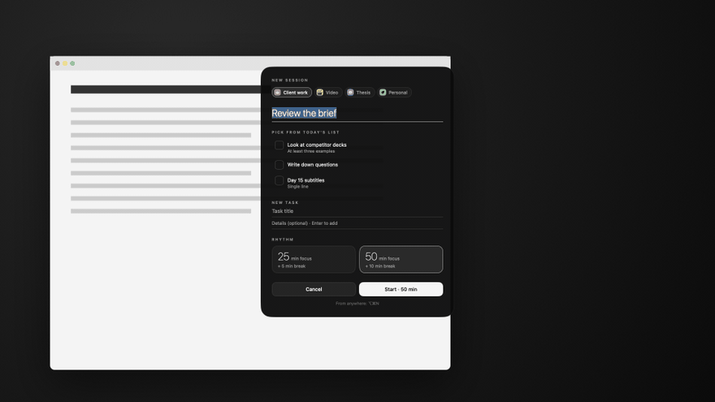
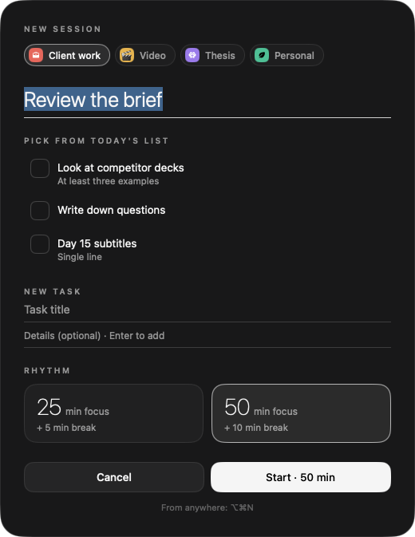
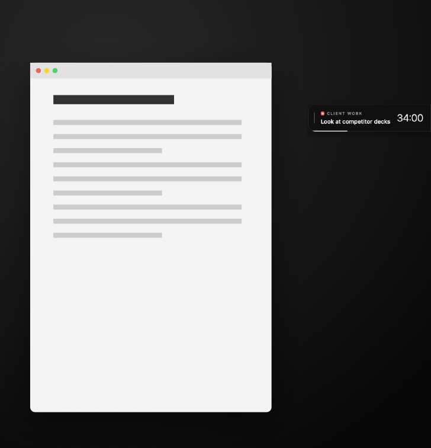
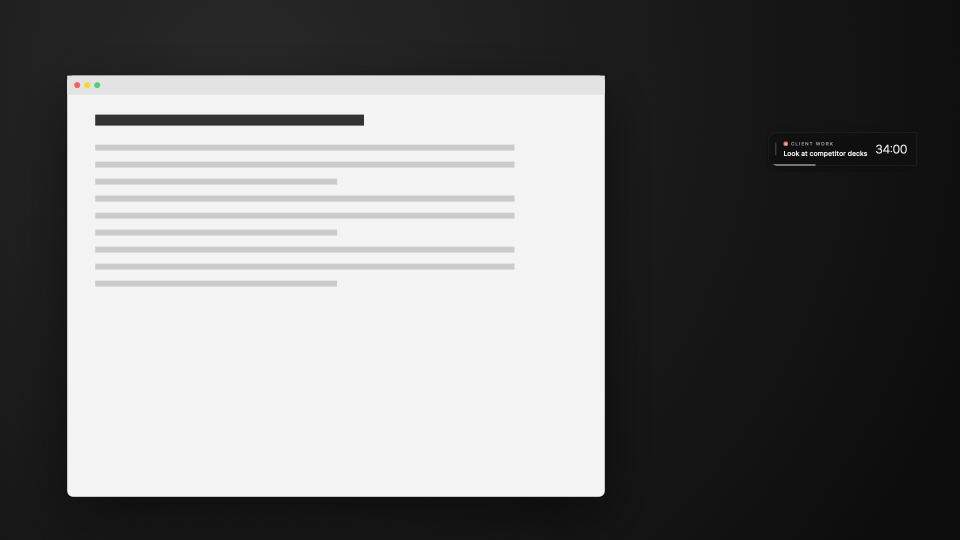
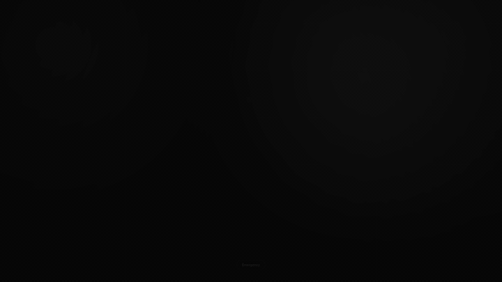
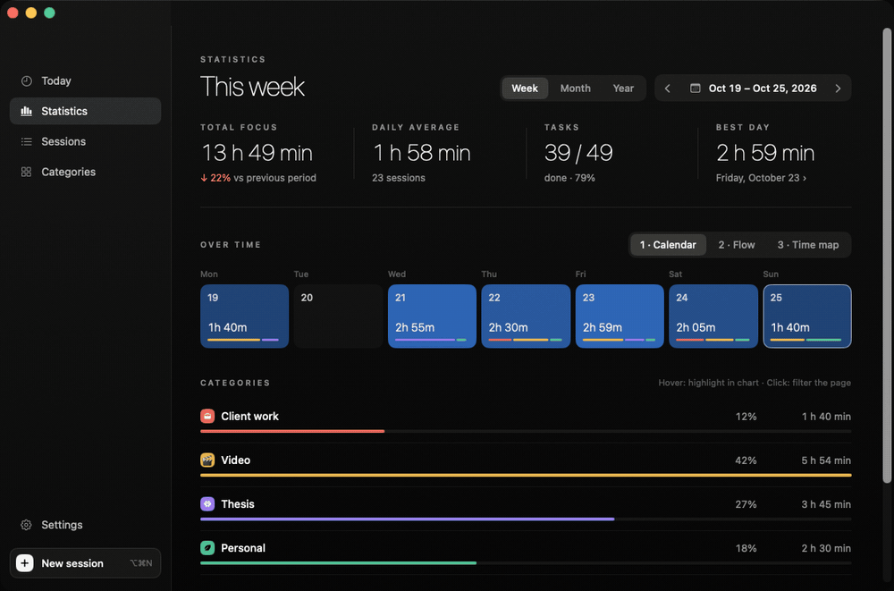
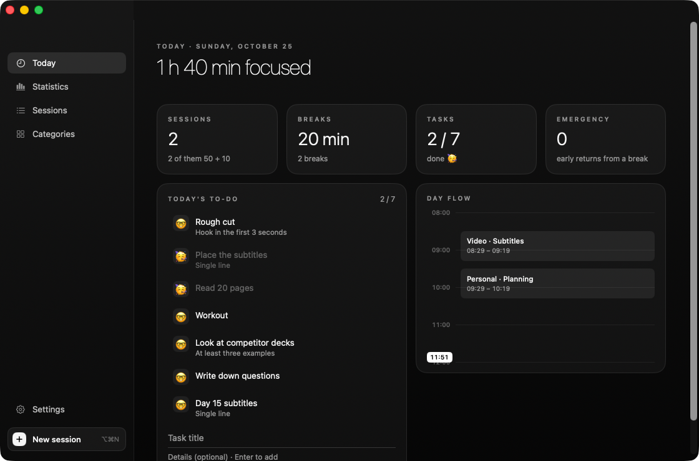
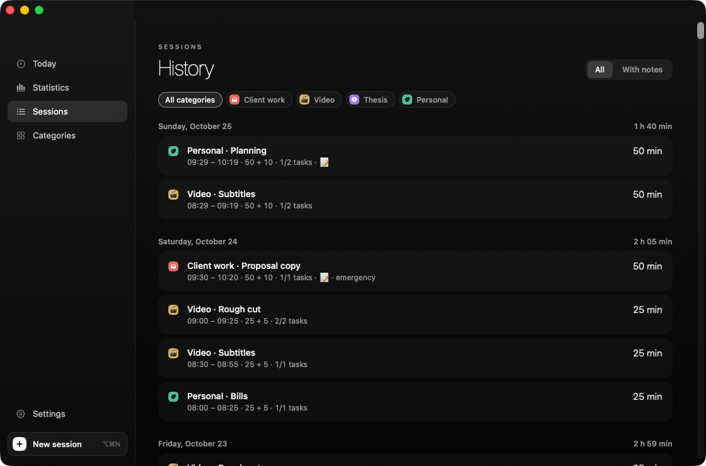
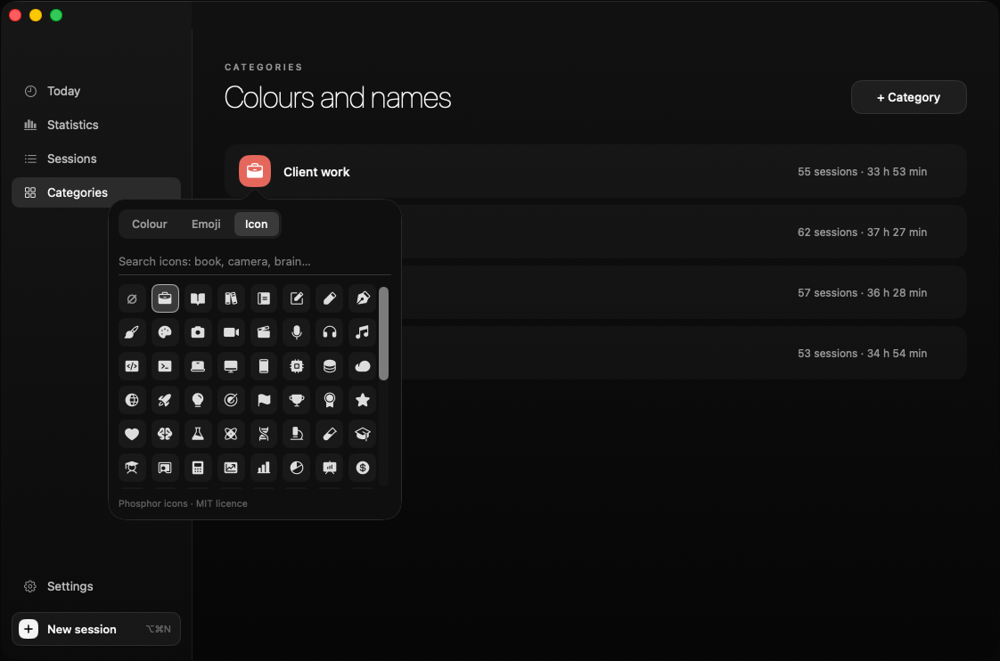
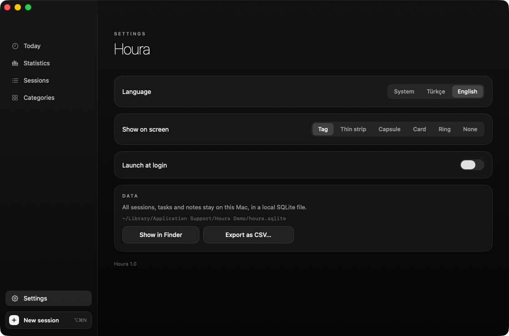

<p align="center">
  
</p>

<h1 align="center">Houra</h1>

<p align="center">
  <b>A calm, black-and-white focus timer for the macOS menu bar.</b><br>
  Plan the session, work in the open, and get pulled away from the screen when the break comes.
</p>

<p align="center">
  <b>English</b> · <a href="README.tr.md">Türkçe</a>
</p>

<p align="center">
  
</p>

---

Houra is a focus timer built around three ideas:

1. **Decide before you start.** Every session begins with a category, a goal and, if you want, a short to-do list picked from today's tasks. Once the session runs, the list is locked: you finish what you planned instead of adding more.
2. **Keep time in sight without a window in the way.** A small tag, strip, capsule, card or ring floats at the edge of your screen. Hover over it and the full session slides out; move away and it hides again.
3. **Really take the break.** When the time is up, a full-screen break covers every display. It only lets you back in early through a deliberate, press-and-hold *Emergency* button.

Everything stays on your Mac in a local SQLite file. There is no account, no sync and no tracking.

*Houra* comes from *hour*. The interface is available in English and Turkish.

## Contents

- [Sessions](#sessions)
- [On-screen views](#on-screen-views)
- [Break screen](#break-screen)
- [Statistics](#statistics)
- [Today, sessions and categories](#today-sessions-and-categories)
- [Installation](#installation)
- [Keyboard shortcuts](#keyboard-shortcuts)
- [Your data](#your-data)
- [Building and contributing](#building-and-contributing)

## Sessions



Start a session from the menu bar, from the panel, or from anywhere with **⌥⌘N**.

- **Category:** each category has its own colour and, optionally, an emoji or one of 100 built-in icons.
- **Goal:** answer *What are you focusing on?* in a few words.
- **Tasks:** tick tasks from today's list, or write new ones with a title and optional details. New tasks are added to today's list too.
- **Rhythm:** two fixed rhythms, **25 + 5** and **50 + 10**. No fiddling with minutes.

During the session every task has three states, cycled with a click:

| | |
|---|---|
| 🤓 | to do |
| 🙂‍↔️ | doing right now (only one at a time) |
| 🥳 | done |

Each session also has a free-form **Notes** field. Notes and tasks are kept with the session and show up later in *Sessions*.

<br clear="right">

## On-screen views

<p align="center">
  
</p>

While a session runs, Houra shows the remaining time and the task you are on in one of five views. Choose it in *Show on screen*:

| View | What it looks like |
|---|---|
| **Tag** | A label stuck to the screen edge: category, current task and time, with a thin progress line. |
| **Thin strip** | A 5-pixel line along the edge that fills from the bottom; the time rides on top of it. |
| **Capsule** | A floating pill with the task, the time and a pause button wrapped in a progress ring. |
| **Card** | A floating card with a large progress ring. |
| **Ring** | Just a small ring with the time inside. |

**Hover** over any view for a moment and the detail panel opens: the big countdown, *Pause* and *Finish*, the task list, your notes and a timeline of today. Move the mouse away and it closes. While you are typing a note it stays open.

**Press and drag** to move a view. The tag and the strip snap to the nearest edge, left or right, and the detail panel then opens from that side. The capsule, card and ring stay exactly where you drop them. Positions are remembered.

<p align="center">
  
</p>

## Break screen

<p align="center">
  
</p>

When the focus time ends, or when you press *Finish*, a slow black-and-white scene covers every screen with the break countdown. App switching is blocked on purpose.

If something really cannot wait, **press and hold *Emergency* for 1.5 seconds**. The break keeps running in the menu bar, the early exit is recorded, and you can return to the break from the menu. When the break ends, Houra asks about your next session.

## Statistics

<p align="center">
  
</p>

This is the only place in Houra that uses colour, so your categories stand out.

- **Periods:** week, month, year, or any range picked from the calendar (with *last 7 / 30 / 90 days* shortcuts). Step through periods with ‹ ›.
- **At a glance:** total focus with the change from the previous period, daily average, finished tasks, and your best day.
- **Three charts:**
  - **Calendar:** every day is a tile that gets brighter the more you focused, with a thin line showing the category mix. Long ranges turn into a year grid.
  - **Flow:** categories stacked as smooth layers over time.
  - **Time map:** one row per day, sessions placed at the real hours you worked them.
- **Categories:** hover a category to highlight it in the chart, click it to filter the whole page by it.
- **Most productive hours:** a 24-hour strip of when you actually focus.
- **Day details:** click any day for its category split, sessions, rhythms and tasks.

## Today, sessions and categories

<p align="center">
  
  
</p>

- **Today:** today's focus, breaks, tasks and emergency exits; today's to-do list; and a vertical timeline of your sessions.
- **Sessions:** your history grouped by day, filterable by category or *with notes*. Click a session to see its tasks and notes.

<p align="center">
  
  
</p>

- **Categories:** rename a category in place. Click its square to pick a colour (or any custom colour), an emoji, or one of 100 [Phosphor](https://phosphoricons.com) icons, searchable in English and Turkish. Icons switch between black and white automatically, based on how light the colour is.
- **Settings:** language (system, Türkçe, English), on-screen view, launch at login, and your data.

### Menu bar

The menu bar icon is a square inside a square. During a session only the outer square stays, and it draws itself around as time passes, next to the remaining time. During a break it shows the break countdown. From the menu you can start a session, repeat a recent one, pause or finish, switch the on-screen view and open the panel.

## Installation

### Download

1. Download **`Houra-<version>.dmg`** from the [latest release](https://github.com/serbestonline/Houra/releases/latest).
2. Open it and drag **Houra** onto **Applications**.
3. Launch Houra. It lives in the menu bar; there is no Dock icon until you open the panel.

Requires **macOS 13 or later**. Runs natively on Apple Silicon and Intel Macs.

> **First launch:** Houra is not notarized by Apple, so the first time you open it macOS says it couldn't verify the app. Go to **System Settings › Privacy & Security**, scroll down and click **Open Anyway**. You only need to do this once.
> Or remove the quarantine flag in Terminal: `xattr -dr com.apple.quarantine /Applications/Houra.app`

### Build from source

Requirements: macOS 13 or later and the Xcode Command Line Tools. There is no Xcode project and no third-party dependency.

```bash
xcode-select --install          # if the Command Line Tools are not installed yet

git clone https://github.com/serbestonline/Houra.git
cd Houra
./build.sh --install            # builds and installs to ~/Applications
open ~/Applications/Houra.app
```

| Command | Result |
|---|---|
| `./build.sh` | Builds a universal `build/Houra.app` (Apple Silicon + Intel) |
| `./build.sh --install` | Also installs it to `~/Applications` |
| `./build.sh --dmg` | Also creates the drag-to-install `build/Houra-<version>.dmg` (requires [uv](https://docs.astral.sh/uv/)) |

## Keyboard shortcuts

| Key | Action |
|---|---|
| `⌥⌘N` | New session, from anywhere |
| `⌘N` | New session (menu) |
| `⌘.` | Pause / resume (menu) |
| `⌘P` | Open the panel (menu) |
| `⌘,` | Settings (menu) |
| `Return` | Start the session in the new session window |
| `Esc` | Close the new session window |

## Your data

All categories, tasks, sessions and notes are stored in a single SQLite file:

```
~/Library/Application Support/Houra/houra.sqlite
```

Nothing leaves your Mac. From *Settings* you can reveal the file in Finder or export every session as CSV. If you quit Houra in the middle of a session, it is closed with its planned length the next time Houra starts.

## Building and contributing

The app is plain Swift (AppKit + SwiftUI) in `Sources/`:

| File | What it does |
|---|---|
| `Focus.swift` | The session engine: focus, pause, break, tasks |
| `MenuBar.swift` | Menu bar icon, menu and the ⌥⌘N hotkey |
| `Widgets.swift`, `DetailView.swift` | On-screen views and their hover panel |
| `NewSession.swift`, `RestOverlay.swift` | New session window and the break screen |
| `Panel.swift`, `Stats.swift` | The panel and the statistics page |
| `Store.swift` | SQLite storage |
| `Icons.swift`, `IconData.swift` | The 100 embedded icons and a small SVG path parser |

Run the self-test with `build/Houra.app/Contents/MacOS/Houra --selftest`.

The screenshots and GIFs in this README are produced by the app itself on sample data: `./scripts/make_media.sh` builds the app, seeds a separate demo database and records each scenario. Houra captures only its own windows, so no screen-recording permission is needed.

## Credits

- Icons: [Phosphor Icons](https://phosphoricons.com) (MIT), fetched through [Iconify](https://iconify.design).
- Made by [Serbest](https://github.com/serbestonline).

## License

MIT
